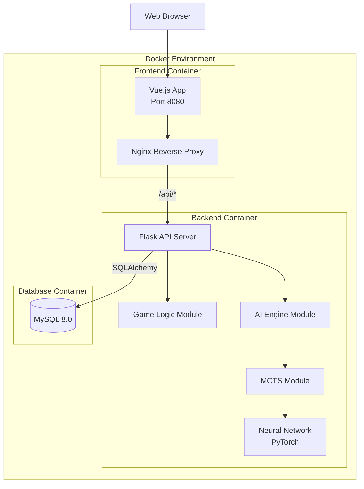
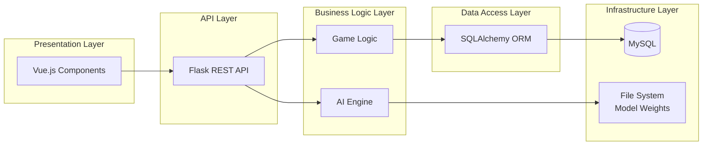
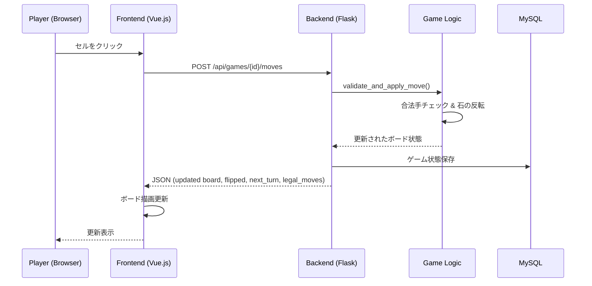
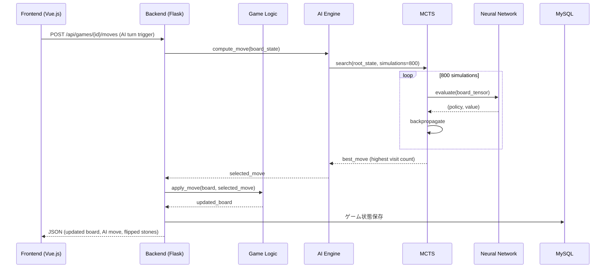

# Technical Design Document

## Overview

本設計ドキュメントは、AlphaZeroアーキテクチャベースのAIと対戦可能なオセロWebアプリケーションの技術設計を定義する。

### システム概要

本システムは以下の主要コンポーネントで構成される：

1. **フロントエンド（Vue.js）**: ゲームボードの描画、ユーザーインタラクション、リアルタイムのゲーム状態表示
2. **バックエンド（Python Flask）**: ゲームロジック、API提供、AIエンジンとの連携
3. **AIエンジン（PyTorch）**: AlphaZeroアーキテクチャに基づくMCTS + ニューラルネットワーク
4. **データベース（MySQL）**: 対局履歴の永続化
5. **Docker環境**: 全サービスのコンテナオーケストレーション

### 設計方針

- **関心の分離**: フロントエンド、バックエンド、AI、データベースを独立したコンテナとして構成
- **REST API**: フロントエンドとバックエンド間の通信はRESTful APIで行う
- **モデルの再利用性**: AIエンジンは対戦モードとセルフプレイ学習モードの両方で同じニューラルネットワークを使用
- **スケーラビリティ**: Docker構成により将来的な水平スケーリングに対応可能な設計

## Architecture

### システムアーキテクチャ図



### レイヤードアーキテクチャ



### リクエストフロー（プレイヤーの手番）



### リクエストフロー（AIの手番）



## Components and Interfaces

### フロントエンド（Vue.js）

#### コンポーネント構成

```
src/
├── App.vue
├── main.js
├── router/
│   └── index.js
├── stores/
│   └── gameStore.js          # Pinia store for game state
├── api/
│   └── gameApi.js            # API client
├── components/
│   ├── GameBoard.vue         # 8×8ゲームボード
│   ├── BoardCell.vue         # 個別セル（石/合法手表示）
│   ├── GameStatus.vue        # ターン表示・石カウント
│   ├── ThinkingIndicator.vue # AI思考中表示
│   ├── GameResult.vue        # 対局結果表示
│   └── GameHistory.vue       # 対局履歴一覧
├── views/
│   ├── GameView.vue          # ゲーム画面
│   └── HistoryView.vue       # 履歴画面
└── utils/
    └── boardUtils.js         # ボード操作ユーティリティ
```

#### 主要インターフェース

```typescript
// gameApi.js - API Client Interface
interface GameApi {
  createGame(): Promise<GameResponse>
  getGame(gameId: string): Promise<GameResponse>
  makeMove(gameId: string, row: number, col: number): Promise<MoveResponse>
  getHistory(page?: number): Promise<HistoryResponse>
}

// GameResponse
interface GameResponse {
  id: string
  board: number[][]        // 8×8 (0=empty, 1=black, 2=white)
  current_turn: 'black' | 'white'
  legal_moves: [number, number][]
  stone_count: { black: number, white: number }
  status: 'in_progress' | 'finished'
  result?: 'black_win' | 'white_win' | 'draw'
}

// MoveResponse
interface MoveResponse {
  board: number[][]
  move: { row: number, col: number }
  flipped: [number, number][]
  current_turn: 'black' | 'white'
  legal_moves: [number, number][]
  stone_count: { black: number, white: number }
  status: 'in_progress' | 'finished'
  result?: 'black_win' | 'white_win' | 'draw'
}
```

### バックエンド（Python Flask）

#### モジュール構成

```
backend/
├── app.py                    # Flask application factory
├── config.py                 # Configuration
├── requirements.txt
├── routes/
│   └── game_routes.py        # API endpoints
├── services/
│   ├── game_service.py       # Game orchestration
│   └── history_service.py    # History retrieval
├── models/
│   ├── game_session.py       # SQLAlchemy model
│   └── database.py           # DB initialization
├── game/
│   ├── board.py              # Board state & logic
│   ├── rules.py              # Othello rules engine
│   └── constants.py          # Game constants
├── ai/
│   ├── engine.py             # AI Engine orchestrator
│   ├── mcts.py               # MCTS implementation
│   ├── neural_network.py     # PyTorch model definition
│   ├── board_encoder.py      # Board state → tensor
│   └── self_play.py          # Self-play training
└── tests/
    ├── test_board.py
    ├── test_rules.py
    ├── test_mcts.py
    └── test_neural_network.py
```

#### 主要クラスインターフェース

```python
# game/board.py
class Board:
    """8×8オセロ盤の状態管理"""
    
    EMPTY = 0
    BLACK = 1
    WHITE = 2
    
    def __init__(self, state: Optional[List[List[int]]] = None):
        """初期盤面またはstate指定で生成"""
    
    def get_state(self) -> List[List[int]]:
        """現在の盤面状態を返す"""
    
    def place_stone(self, row: int, col: int, color: int) -> List[Tuple[int, int]]:
        """石を配置し、反転した石の座標リストを返す"""
    
    def get_legal_moves(self, color: int) -> List[Tuple[int, int]]:
        """指定色の合法手リストを返す"""
    
    def count_stones(self) -> Dict[str, int]:
        """黒白の石数を返す"""
    
    def is_full(self) -> bool:
        """盤面が全て埋まっているか"""
    
    def copy(self) -> 'Board':
        """盤面のディープコピーを返す"""


# game/rules.py
class OthelloRules:
    """オセロルールエンジン"""
    
    @staticmethod
    def is_valid_move(board: Board, row: int, col: int, color: int) -> bool:
        """指定位置が合法手かどうか判定"""
    
    @staticmethod
    def get_flipped_stones(board: Board, row: int, col: int, color: int) -> List[Tuple[int, int]]:
        """配置時に反転される石の座標を返す"""
    
    @staticmethod
    def is_game_over(board: Board, current_color: int) -> bool:
        """ゲーム終了条件を判定"""
    
    @staticmethod
    def determine_winner(board: Board) -> Optional[int]:
        """勝者を判定（None=ドロー）"""


# ai/engine.py
class AIEngine:
    """AlphaZero AIエンジン"""
    
    def __init__(self, model_path: str, simulations: int = 800, timeout: float = 5.0):
        """モデルをロードしてエンジンを初期化"""
    
    def compute_move(self, board: Board, color: int) -> Tuple[int, int]:
        """MCTSを実行し最善手を返す（タイムアウト付き）"""
    
    def load_model(self, model_path: str) -> None:
        """事前学習済みモデルの重みをロード"""


# ai/mcts.py
class MCTSNode:
    """MCTSの探索木ノード"""
    
    def __init__(self, board: Board, color: int, parent=None, move=None):
        """ノードを初期化"""
    
    @property
    def visit_count(self) -> int: ...
    
    @property
    def value(self) -> float: ...


class MCTS:
    """Monte Carlo Tree Search"""
    
    def __init__(self, neural_network: NeuralNetwork, simulations: int = 800, c_puct: float = 1.0):
        """MCTSを初期化"""
    
    def search(self, board: Board, color: int) -> Tuple[int, int]:
        """探索を実行し、最も訪問数の多い手を返す"""
    
    def get_policy(self, board: Board, color: int) -> List[float]:
        """MCTS探索後のポリシー（訪問比率）を返す"""


# ai/neural_network.py
class OthelloNet(torch.nn.Module):
    """AlphaZeroニューラルネットワーク"""
    
    def __init__(self, num_residual_blocks: int = 10, num_filters: int = 128):
        """ResNetベースのネットワークを構築"""
    
    def forward(self, x: torch.Tensor) -> Tuple[torch.Tensor, torch.Tensor]:
        """入力テンソル(batch, 3, 8, 8)→(policy[batch, 64], value[batch, 1])"""


class NeuralNetwork:
    """ニューラルネットワークのラッパー"""
    
    def __init__(self, model_path: Optional[str] = None):
        """モデルを初期化（オプショナルに重みをロード）"""
    
    def predict(self, board: Board, color: int) -> Tuple[np.ndarray, float]:
        """盤面を評価し(policy[64], value)を返す"""
    
    def encode_board(self, board: Board, color: int) -> torch.Tensor:
        """盤面を3×8×8テンソルにエンコード"""
    
    def load_weights(self, path: str) -> None:
        """モデル重みをファイルからロード"""
    
    def save_weights(self, path: str) -> None:
        """モデル重みをファイルに保存"""


# ai/self_play.py
class SelfPlay:
    """セルフプレイによる学習データ生成・学習"""
    
    def __init__(self, neural_network: NeuralNetwork, config: SelfPlayConfig):
        """セルフプレイモジュールを初期化"""
    
    def generate_games(self, num_games: int) -> List[TrainingSample]:
        """指定数のゲームをセルフプレイで生成"""
    
    def train(self, samples: List[TrainingSample]) -> TrainingSummary:
        """収集したデータでモデルを学習"""
    
    def run(self) -> TrainingSummary:
        """セルフプレイ→学習の一連の流れを実行"""
```

### API エンドポイント詳細

| Method | Endpoint | Description | Request Body | Response |
|--------|----------|-------------|--------------|----------|
| POST | /api/games | 新規ゲーム作成 | なし | GameResponse (201) |
| GET | /api/games/{id} | ゲーム状態取得 | なし | GameResponse (200) |
| POST | /api/games/{id}/moves | 手を打つ | `{row, col}` | MoveResponse (200) |
| GET | /api/games | 対局履歴一覧 | query: page, per_page | HistoryResponse (200) |
| GET | /api/games/{id}/replay | リプレイデータ取得 | なし | ReplayResponse (200) |

### エラーレスポンスフォーマット

```json
{
  "error": {
    "code": "INVALID_MOVE",
    "message": "The specified cell is not a legal move position"
  }
}
```

エラーコード一覧：
- `INVALID_MOVE`: 不正な手
- `GAME_NOT_FOUND`: ゲームが見つからない
- `INVALID_PARAMETERS`: パラメータ不正
- `AI_TIMEOUT`: AIタイムアウト
- `MODEL_LOAD_ERROR`: モデルロード失敗
- `INTERNAL_ERROR`: 内部エラー

## Data Models

### データベーススキーマ

```sql
CREATE TABLE game_sessions (
    id CHAR(36) PRIMARY KEY,          -- UUID
    player_id VARCHAR(255),            -- プレイヤー識別子
    result ENUM('black_win', 'white_win', 'draw') NULL,
    move_sequence JSON,                -- 手順リスト [{"row":2,"col":3}, ...]
    status ENUM('in_progress', 'finished') NOT NULL DEFAULT 'in_progress',
    board_state JSON,                  -- 現在の盤面状態
    current_turn ENUM('black', 'white') NOT NULL DEFAULT 'black',
    started_at TIMESTAMP NOT NULL DEFAULT CURRENT_TIMESTAMP,
    ended_at TIMESTAMP NULL,
    created_at TIMESTAMP NOT NULL DEFAULT CURRENT_TIMESTAMP,
    updated_at TIMESTAMP NOT NULL DEFAULT CURRENT_TIMESTAMP ON UPDATE CURRENT_TIMESTAMP,
    INDEX idx_player_ended (player_id, ended_at DESC),
    INDEX idx_status (status)
) ENGINE=InnoDB DEFAULT CHARSET=utf8mb4;
```

### SQLAlchemy モデル

```python
from sqlalchemy import Column, String, Enum, JSON, DateTime
from sqlalchemy.sql import func
from database import db
import uuid

class GameSession(db.Model):
    __tablename__ = 'game_sessions'
    
    id = Column(String(36), primary_key=True, default=lambda: str(uuid.uuid4()))
    player_id = Column(String(255), nullable=True)
    result = Column(Enum('black_win', 'white_win', 'draw'), nullable=True)
    move_sequence = Column(JSON, nullable=False, default=list)
    status = Column(Enum('in_progress', 'finished'), nullable=False, default='in_progress')
    board_state = Column(JSON, nullable=False)
    current_turn = Column(Enum('black', 'white'), nullable=False, default='black')
    started_at = Column(DateTime, nullable=False, server_default=func.now())
    ended_at = Column(DateTime, nullable=True)
    created_at = Column(DateTime, nullable=False, server_default=func.now())
    updated_at = Column(DateTime, nullable=False, server_default=func.now(), onupdate=func.now())
```

### ドメインモデル

```python
# ゲームボード状態
@dataclass
class BoardState:
    cells: List[List[int]]  # 8×8, 0=empty, 1=black, 2=white
    
    def to_dict(self) -> dict:
        return {"cells": self.cells}
    
    @classmethod
    def from_dict(cls, data: dict) -> 'BoardState':
        return cls(cells=data["cells"])
    
    @classmethod
    def initial(cls) -> 'BoardState':
        """初期盤面（中央に黒2白2）"""
        cells = [[0]*8 for _ in range(8)]
        cells[3][3] = 2  # white
        cells[3][4] = 1  # black
        cells[4][3] = 1  # black
        cells[4][4] = 2  # white
        return cls(cells=cells)


# 学習サンプル
@dataclass
class TrainingSample:
    board_tensor: torch.Tensor   # shape: (3, 8, 8)
    policy: np.ndarray           # shape: (64,), sum=1.0
    value: float                 # -1.0 to 1.0


# セルフプレイ設定
@dataclass
class SelfPlayConfig:
    num_games: int = 100           # 1-10000
    simulations: int = 800         # 1-10000
    learning_rate: float = 0.001   # 0.0001-0.1
    batch_size: int = 64           # 1-1024
    epochs: int = 10               # 1-1000


# 学習サマリー
@dataclass
class TrainingSummary:
    games_played: int
    total_samples: int
    final_loss: float
```

### ニューラルネットワーク入出力仕様

**入力テンソル**: `float32[3][8][8]`
- Channel 0: 現在のプレイヤーの石 (1.0/0.0)
- Channel 1: 相手プレイヤーの石 (1.0/0.0)
- Channel 2: 手番情報 (黒番=全1.0, 白番=全0.0)

**出力**:
- Policy: `float32[64]` — softmax正規化済み、非合法手はマスク後再正規化
- Value: `float32` — tanh活性化、範囲[-1, 1]

## Correctness Properties

*プロパティとは、システムのすべての有効な実行にわたって成り立つべき特性や振る舞いのことで、本質的にはシステムが何をすべきかについての形式的な記述です。プロパティは、人間が読める仕様と機械で検証可能な正しさの保証の橋渡しとして機能します。*

### Property 1: 合法手の健全性と完全性

*For any* 有効なオセロ盤面と色について、`get_legal_moves`が返す手の集合は、その色の石を置いた場合に少なくとも1つの相手の石を反転できる全ての空セルの集合と正確に一致しなければならない。

**Validates: Requirements 2.1, 2.6**

### Property 2: 不正な手の拒否と状態保持

*For any* 有効なオセロ盤面と不正な位置（盤外、既に石がある、反転可能な石がない）について、その手を適用しようとした場合、手は拒否され、盤面状態は操作前と完全に同一でなければならない。

**Validates: Requirements 2.2**

### Property 3: 石反転の正確性

*For any* 有効なオセロ盤面と合法手について、石を置いた後に反転される石の集合は、置いた石と同色の既存石の間に挟まれた相手の石（8方向全て）の集合と正確に一致し、それ以外の石は変更されてはならない。

**Validates: Requirements 2.3**

### Property 4: パス処理の正確性

*For any* 有効なオセロ盤面において、現在のプレイヤーに合法手がなく相手プレイヤーに合法手がある場合、ターンは相手プレイヤーに渡されなければならない。

**Validates: Requirements 2.4**

### Property 5: ゲーム終了と勝者判定

*For any* 終了状態のオセロ盤面（両プレイヤーとも合法手なし、または盤面が全て埋まっている）について、勝者は石数がより多いプレイヤーと判定され、同数の場合は引き分けと判定されなければならない。

**Validates: Requirements 2.5**

### Property 6: 盤面エンコーディングのラウンドトリップ

*For any* 有効なオセロ盤面と手番色について、盤面をテンソル（3×8×8）にエンコードし、そのテンソルをデコードして得られた盤面は、元の盤面の全セル（空、黒、白）が同一でなければならない。

**Validates: Requirements 8.1, 8.4**

### Property 7: ニューラルネットワーク出力の不変条件

*For any* 有効な盤面テンソル入力（3×8×8）について、ニューラルネットワークの出力は以下を全て満たさなければならない：(a) ポリシーベクトルのサイズは64、(b) 非合法手の確率は0、(c) 合法手の確率の合計は1.0（許容誤差1e-6以内）、(d) バリュースカラーは[-1, 1]の範囲内。

**Validates: Requirements 4.2, 4.8, 8.2, 8.3, 8.5**

### Property 8: MCTS手選択の正確性

*For any* MCTS探索完了後の状態について、選択される手は合法手の中で最も訪問回数が多いノードに対応する手でなければならない。

**Validates: Requirements 4.5**

### Property 9: リプレイ状態再構築の正確性

*For any* 有効な手順シーケンス（初期盤面から合法手のみの連続）について、初期盤面から各手を順に適用して得られる中間盤面は、その時点での正しいオセロ盤面状態と一致しなければならない。

**Validates: Requirements 5.4**

### Property 10: 学習サンプルの妥当性

*For any* セルフプレイで生成された学習サンプルについて、盤面テンソルの形状は(3, 8, 8)、ポリシーベクトルの合計は1.0（許容誤差1e-6以内）、ゲーム結果値は{-1, 0, 1}のいずれかでなければならない。

**Validates: Requirements 9.2**

### Property 11: セルフプレイパラメータの範囲検証

*For any* セルフプレイパラメータの組み合わせについて、各パラメータが有効範囲内（num_games: 1-10000, simulations: 1-10000, learning_rate: 0.0001-0.1, batch_size: 1-1024, epochs: 1-1000）であれば受理され、範囲外であれば拒否されなければならない。

**Validates: Requirements 9.5**

## Error Handling

### エラーハンドリング戦略

#### バックエンド（Flask）

| エラー種別 | 検出方法 | 対応 | HTTPステータス |
|-----------|---------|------|--------------|
| 不正な手 | OthelloRules.is_valid_move() | エラーレスポンス返却 | 400 |
| ゲーム未検出 | DB検索結果なし | 404レスポンス | 404 |
| パラメータ不正 | リクエストバリデーション | エラー理由付きレスポンス | 400 |
| AIタイムアウト | threading.Timer(5.0) | 計算中断、パス処理 | 200 (timeout通知付き) |
| モデルロード失敗 | FileNotFoundError/torch.load例外 | エラーレスポンス | 500 |
| DB保存失敗 | SQLAlchemy例外 | 3回リトライ後エラー | 500 |
| 内部エラー | グローバル例外ハンドラ | 詳細非公開エラー | 500 |

#### AIエンジン

```python
class AIEngineError(Exception):
    """AIエンジンの基底例外"""
    pass

class ModelLoadError(AIEngineError):
    """モデルファイルのロード失敗"""
    pass

class AITimeoutError(AIEngineError):
    """AI計算のタイムアウト"""
    pass

class InvalidBoardStateError(AIEngineError):
    """無効な盤面状態の入力"""
    pass
```

#### タイムアウト処理

```python
import signal
import threading

def compute_move_with_timeout(self, board: Board, color: int, timeout: float = 5.0) -> Tuple[int, int]:
    """タイムアウト付きのAI手計算"""
    result = [None]
    exception = [None]
    
    def target():
        try:
            result[0] = self._mcts.search(board, color)
        except Exception as e:
            exception[0] = e
    
    thread = threading.Thread(target=target)
    thread.start()
    thread.join(timeout=timeout)
    
    if thread.is_alive():
        # タイムアウト: 計算を中断
        raise AITimeoutError(f"AI computation exceeded {timeout}s timeout")
    
    if exception[0]:
        raise exception[0]
    
    return result[0]
```

#### DB保存リトライ

```python
import time
from sqlalchemy.exc import SQLAlchemyError

MAX_RETRIES = 3
RETRY_DELAY = 1.0  # seconds

def save_game_with_retry(session: GameSession) -> bool:
    for attempt in range(MAX_RETRIES):
        try:
            db.session.add(session)
            db.session.commit()
            return True
        except SQLAlchemyError as e:
            db.session.rollback()
            if attempt < MAX_RETRIES - 1:
                time.sleep(RETRY_DELAY * (attempt + 1))
            else:
                raise
    return False
```

#### フロントエンド

- API呼び出し失敗時: ユーザーにエラーメッセージを表示（トースト通知）
- ネットワーク切断: 再接続試行 + オフライン状態表示
- 不正操作: 無効な手クリック時に視覚的フィードバック（1秒以上表示）

#### セッション管理

- プレイヤー切断時: サーバー側でGame_Sessionを300秒保持
- 保持期間中に再接続: セッション状態を復元してゲーム続行
- 300秒経過: セッションを「abandoned」として記録

## Testing Strategy

### テストアプローチ

本プロジェクトでは**ユニットテスト**と**プロパティベーステスト**の二重アプローチを採用する。

### プロパティベーステスト

**ライブラリ**: [Hypothesis](https://hypothesis.readthedocs.io/) (Python)

**設定**:
- 各プロパティテストは最低100回のイテレーション
- 各テストはデザインドキュメントのプロパティを参照するタグ付き
- タグフォーマット: `Feature: othello-ai-app, Property {number}: {property_text}`

**対象プロパティ**:

| Property | テスト対象モジュール | ジェネレータ |
|----------|-------------------|------------|
| Property 1 | game/board.py, game/rules.py | 有効なオセロ盤面ジェネレータ |
| Property 2 | game/board.py, game/rules.py | 盤面 + 不正位置ジェネレータ |
| Property 3 | game/board.py, game/rules.py | 盤面 + 合法手ジェネレータ |
| Property 4 | game/rules.py | パス状態盤面ジェネレータ |
| Property 5 | game/rules.py | 終了状態盤面ジェネレータ |
| Property 6 | ai/board_encoder.py | 有効なオセロ盤面ジェネレータ |
| Property 7 | ai/neural_network.py | 有効な盤面テンソルジェネレータ |
| Property 8 | ai/mcts.py | MCTS探索結果ジェネレータ |
| Property 9 | services/game_service.py | 有効な手順シーケンスジェネレータ |
| Property 10 | ai/self_play.py | セルフプレイ出力ジェネレータ |
| Property 11 | ai/self_play.py | パラメータ範囲ジェネレータ |

**カスタムジェネレータ例**:

```python
from hypothesis import strategies as st
from hypothesis import given

# 有効なオセロ盤面ジェネレータ
@st.composite
def valid_board_states(draw):
    """ランダムだが有効なオセロ盤面を生成"""
    board = Board()  # 初期盤面から開始
    num_moves = draw(st.integers(min_value=0, max_value=58))
    
    current_color = Board.BLACK
    consecutive_passes = 0
    
    for _ in range(num_moves):
        legal_moves = board.get_legal_moves(current_color)
        if not legal_moves:
            consecutive_passes += 1
            if consecutive_passes >= 2:
                break
            current_color = Board.WHITE if current_color == Board.BLACK else Board.BLACK
            continue
        
        consecutive_passes = 0
        move = draw(st.sampled_from(legal_moves))
        board.place_stone(move[0], move[1], current_color)
        current_color = Board.WHITE if current_color == Board.BLACK else Board.BLACK
    
    return board, current_color
```

### ユニットテスト

**ライブラリ**: pytest

**対象**:
- ゲームロジックの具体的なシナリオ（初期配置、角の取り合い等）
- APIエンドポイントの正常系・異常系
- エッジケース（パス、タイムアウト、DB障害）
- フロントエンドコンポーネント（Vue Test Utils + Vitest）

### インテグレーションテスト

- API全エンドポイントのE2Eテスト
- AI + ゲームロジックの統合テスト
- DB永続化の検証
- Docker環境の起動確認

### テスト実行コマンド

```bash
# バックエンドテスト（ユニット + プロパティ）
cd backend && pytest tests/ -v

# プロパティテストのみ
cd backend && pytest tests/ -v -m "property"

# フロントエンドテスト
cd frontend && npm run test

# 全テスト（Docker環境）
docker-compose -f docker-compose.test.yml up --abort-on-container-exit
```

